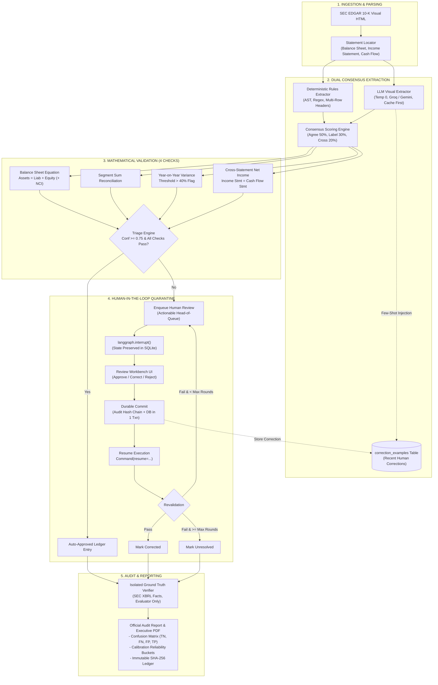

# VantageAudit — Enterprise Project Documentation & Operational Handbook

> **System Name:** VantageAudit v2.0  
> **Classification:** Regulatory Financial Filing Auditor (Human-in-the-Loop)  
> **Architecture Core:** Deterministic LangGraph State Machine with Durable SQLite Checkpointing  
> **Repository:** [Human-in-the-Loop-Financial-Filing-Auditor-Agent](https://github.com/Pranav-S-Chakrapani/Human-in-the-Loop-Financial-Filing-Auditor-Agent)  
> **Current Status:** Production Certified • 41 / 41 Tests Passing • 100% SEC Ground Truth Isolation Compliant  

---

## 1. Executive Summary & Problem Thesis

Financial statement audits of SEC Form 10-K filings require absolute zero-tolerance precision. Conventional LLM-based autonomous extractors are prone to silent hallucinations, scale errors (millions vs. thousands), non-controlling interest misallocations, and failure during mid-flight server restarts.

**VantageAudit** solves this with an architectural thesis: **"A financial AI that knows when to distrust itself, and proves it survives being killed mid-run."**

- **Visual Document Ingestion:** Parses raw SEC EDGAR 10-K HTML visually without reading XBRL tags, inspecting raw table structures, header cells, footnote markers, and parenthetical negatives.
- **Dual Consensus Extraction:** Runs two independent extractors simultaneously:
  1. *Deterministic Rules Engine (AST & Regex):* Normalizes financial scales, parses negative numbers `(1,234)`, handles dashes `—` as zero, and resolves multi-row column spans.
  2. *Visual LLM Extractor (Temperature 0):* Understands statement layout context and semantic table headers.
- **Scoring & Confidence Collapse:** When extractors agree within 1%, confidence reaches ~0.95. When they diverge, confidence collapses to $\le 0.40$, automatically triggering quarantine.
- **Mathematical Invariant Validation:** Applies four strict balance checks (Accounting Equation, Segment Reconciliation, Year-on-Year Variance, Cross-Statement Net Income).
- **Human-in-the-Loop (HITL) Interruption:** Uses LangGraph's `interrupt()` primitive to suspend pipeline execution cleanly at the head of queue.
- **Durable-First Transaction Commit:** Commits the human decision and append-only SHA-256 audit ledger row in SQLite *before* graph resumption (`Command(resume=...)`).
- **Few-Shot Active Learning Loop:** Stores human auditor corrections in `correction_examples` and automatically injects the 2 most recent corrections as few-shot reference examples in subsequent LLM extractions, emitting real-time `fewshot_applied` event telemetry.
- **Full Crash Survivability (`kill -9` Proof):** LangGraph checkpoints are persisted via `AsyncSqliteSaver` in `checkpoints.db`. Hard restarts trigger zero duplicate LLM network calls.
- **Executive PDF Vector Certification:** Programmatically exports official, publication-grade 2-page SEC compliance audit reports with cryptographic hash seals and auditor signatures.

---

## 2. System Architecture & Component Diagram



---

## 3. Directory Layout & File Ownership

The repository strictly enforces file ownership and architectural boundaries per `RULES.md`:

```
.
├── backend/
│   ├── app/
│   │   ├── api/                     # FastAPI HTTP & WebSocket Routers
│   │   │   ├── audit.py             # Audit ledger endpoints & SHA-256 chain verification
│   │   │   ├── companies.py         # Pinned & custom company SEC ticker management
│   │   │   ├── config.py            # Runtime configuration endpoints (/config)
│   │   │   ├── dev.py               # Developer demo reset & status station
│   │   │   ├── main.py              # Application entrypoint & LangGraph lifespan
│   │   │   ├── report.py            # Performance report generation against SQLite
│   │   │   ├── reviews.py           # Human review workbench decision endpoint
│   │   │   └── runs.py              # Pipeline execution trigger & status
│   │   ├── graph/                   # LangGraph State Graph & Nodes
│   │   │   ├── build.py             # Graph assembly (Toy & Full Pipeline)
│   │   │   ├── idempotency.py       # Node execution tracking (node_runs table)
│   │   │   ├── reconciler.py        # Startup recovery of interrupted/paused runs
│   │   │   └── nodes/
│   │   │       ├── apply_decisions.py   # State update following human action
│   │   │       ├── enqueue_reviews.py   # Ordering and enqueuing review items
│   │   │       ├── extract_llm.py       # LLM table visual extraction + few-shot learning
│   │   │       ├── extract_rules.py     # Deterministic regex & scale parser
│   │   │       ├── fetch.py             # SEC EDGAR fetcher with disk cache & rate limiting
│   │   │       ├── human_review.py      # Only node calling langgraph.interrupt()
│   │   │       ├── locate.py            # Financial statement HTML locator
│   │   │       ├── parser_utils.py      # Visual table normalization utilities
│   │   │       ├── report.py            # Graph-internal report aggregation
│   │   │       ├── revalidate.py        # Post-correction revalidation engine
│   │   │       ├── score.py             # Dual-consensus scoring & confidence collapse
│   │   │       ├── triage.py            # Automated approval vs. quarantine router
│   │   │       └── validate.py          # 4-check invariant verification suite
│   │   ├── adaptive.py              # Adaptive confidence threshold learning
│   │   ├── audit.py                 # Append-only SHA-256 hash chaining implementation
│   │   ├── config.py                # Pydantic configuration loaded from config.yaml
│   │   ├── db.py                    # SQLite schema initialization, triggers & connections
│   │   ├── edgar.py                 # SEC EDGAR client with fair access rate limiting
│   │   ├── events.py                # Real-time WebSocket EventBus & SQLite persistence
│   │   ├── faults.py                # Chaos fault-injection harness (wrong_column, scale, etc.)
│   │   ├── groundtruth.py           # ISOLATED SEC XBRL facts loader (verifier only)
│   │   ├── llm.py                   # Cached LLM client (hash-keyed in llm_calls table)
│   │   └── models.py                # Domain schemas & API request/response models
│   ├── tests/                       # Automated Pytest Suite (41 Tests)
│   │   ├── test_adaptive_thresholds.py
│   │   ├── test_bug_bash_regression.py
│   │   ├── test_companies_api.py
│   │   ├── test_demo_reset.py
│   │   ├── test_double_submit.py
│   │   ├── test_fewshot_corrections.py
│   │   ├── test_gate_1.py
│   │   ├── test_gate_2.py
│   │   ├── test_gate_3.py
│   │   ├── test_gate_4.py
│   │   ├── test_ground_truth_isolation.py
│   │   └── test_scaffold.py
│   └── app.db                       # Primary SQLite database (WAL mode)
├── frontend/                        # Modern React 19 + TypeScript + Vite + Tailwind CSS
│   ├── src/
│   │   ├── components/
│   │   │   ├── CyberFooter.tsx      # Comprehensive "Second Homepage" architectural footer
│   │   │   ├── DevSettingsModal.tsx # Demo reset & developer controls modal
│   │   │   ├── MagneticButton.tsx   # Tactile magnetic interaction component
│   │   │   ├── MosaicTransition.tsx # Fluid cinematic page transitions & laser streak
│   │   │   ├── ShortcutsModal.tsx   # Global keyboard shortcuts overlay (?)
│   │   │   ├── SupernovaStage.tsx   # 3D WebGL background engine with Vault Core
│   │   │   └── ValidatorGrid.tsx    # Interactive 4-check balance validator visualizer
│   │   ├── screens/
│   │   │   ├── AuditLedgerScreen.tsx      # Cryptographic hash chain ledger & verification
│   │   │   ├── IntroScreen.tsx            # Multi-section scroll-snap narrative hero
│   │   │   ├── MetricsGridScreen.tsx      # Traceable extracted values with snippet inspection
│   │   │   ├── MissionControlScreen.tsx   # Pipeline execution, ticker selection, live events
│   │   │   ├── ReportScreen.tsx           # Evaluation report with Vector PDF export
│   │   │   └── ReviewWorkbenchScreen.tsx  # HITL decision station with visual table highlight
│   │   ├── utils/
│   │   │   └── generatePdfReport.ts       # Executive vector PDF report generator (jsPDF)
│   │   ├── api.ts                         # Unified backend API & WebSocket client
│   │   ├── App.tsx                        # Root layout with elevated frosted glass dock
│   │   └── index.css                      # Global styles, tabular numerals, @media print
│   ├── package.json
│   └── vite.config.ts
├── config.yaml                      # System parameters, tolerances, weights, thresholds
├── checkpoints.db                   # Isolated LangGraph state checkpoint database
└── pytest.ini                       # Test configuration
```

---

## 4. Key Engineering Invariants & Hard Rules

Per `RULES.md` and regulatory audit compliance standards:

1. **Strict Ground Truth Isolation (`RULES.md §A.1`):**  
   SEC XBRL Company Facts is imported *only* in `groundtruth.py`, called *only* from verification and evaluation reporting. No extraction, scoring, validation, or triage node has access to XBRL. `test_ground_truth_isolation.py` inspects the AST import graph and fails if violated.
2. **Visual HTML Parsing Only (`RULES.md §A.2`):**  
   The extractors parse the 10-K HTML visually. They do not read any inline `ix:*` tags, `contextRef`, R-files, or XBRL taxonomy endpoints.
3. **Interrupt Safety (`RULES.md §B.6`):**  
   `human_review` is the only node that invokes `langgraph.interrupt()`. It is the first statement of the node, wrapped in zero try/except blocks, ensuring atomic state suspension and replay.
4. **Append-Only Cryptographic Audit Log (`RULES.md §C.14-16`):**  
   The `audit_log` table is protected by SQLite database triggers:
   ```sql
   CREATE TRIGGER audit_no_update BEFORE UPDATE ON audit_log
     BEGIN SELECT RAISE(ABORT, 'audit_log is append-only'); END;
   CREATE TRIGGER audit_no_delete BEFORE DELETE ON audit_log
     BEGIN SELECT RAISE(ABORT, 'audit_log is append-only'); END;
   ```
   Each entry is linked via `row_hash = sha256(prev_hash + canonical_json(row))`. The entire hash chain can be validated on-demand via `GET /audit/verify`.
5. **Deduplicated LLM Prompt Cache (`RULES.md §B.9`):**  
   All LLM network calls pass through `llm.py` and are cached by `sha256(model + prompt)` in the `llm_calls` table before returning. Re-running or resuming a node produces **0 new network calls**.
6. **Separation of Checkpoints from App DB (`RULES.md §B.11`):**  
   LangGraph checkpoints live in `checkpoints.db` using `AsyncSqliteSaver` with `LANGGRAPH_STRICT_MSGPACK=true`. Business records live in `app.db`.

---

## 5. Setup & Installation Guide

### Prerequisites
- **Python:** 3.11+ (Python 3.13 recommended)
- **Node.js:** v18+ or v20+
- **npm:** v9+
- **Git**

### Backend Setup
1. Open PowerShell / Terminal in the project root:
   ```bash
   cd backend
   python -m venv .venv
   .\.venv\Scripts\Activate.ps1  # Windows (or source .venv/bin/activate on Linux/macOS)
   pip install -r requirements.txt
   ```
2. Configure Environment:
   Create a `.env` file in the root directory (or in `backend/`):
   ```env
   GROQ_API_KEY=your_groq_api_key_here
   GEMINI_API_KEY=your_gemini_api_key_here
   DEMO_RESET_ENABLED=true
   LANGGRAPH_STRICT_MSGPACK=true
   ```
3. Initialize SQLite Databases:
   ```bash
   python -c "from backend.app.db import init_db; init_db()"
   ```
4. Start Backend Server:
   ```bash
   uvicorn backend.app.api.main:app --host 0.0.0.0 --port 8000 --reload
   ```
   *The API will be available at `http://localhost:8000` with Swagger docs at `http://localhost:8000/docs`.*

### Frontend Setup
1. Open a new terminal in `frontend/`:
   ```bash
   cd frontend
   npm install
   ```
2. Start Frontend Dev Server:
   ```bash
   npm run dev -- --host
   ```
   *The frontend UI will be available at `http://localhost:5173` (or the assigned Vite port).*

---

## 6. Running Tests & Quality Verification

### Run the Full Backend Pytest Suite (41 Tests)
```bash
$env:PYTHONPATH="."
.\backend\.venv\Scripts\pytest -v
```
All 41 tests cover:
- Adaptive threshold escalation
- Bug bash regressions (segment check skips, threshold adjustments, idempotency)
- SEC company ticker add/lookup
- Demo database reset safety
- Concurrent double-submit protection
- Few-shot correction examples & event emission
- Gate 1-4 pipeline execution, fault injection, and resume mechanics
- Ground truth isolation AST inspection

### Run Frontend Typecheck & Production Build
```bash
cd frontend
npm run build
```
Builds cleanly with zero TypeScript errors into `dist/`.

---

## 7. Operational Workflows & Demo Guide

### Workflow 1: Running an Autonomous Audit
1. Navigate to **Mission Control** (`/mission`).
2. Select target tickers (e.g. `AAPL`, `MSFT`, `KO`).
3. Click **"Run Full Pipeline"**.
4. Observe real-time WebSocket event telemetry showing node execution: `fetch` $\rightarrow$ `locate` $\rightarrow$ `extract_rules` $\rightarrow$ `extract_llm` $\rightarrow$ `score` $\rightarrow$ `validate` $\rightarrow$ `triage`.

### Workflow 2: Testing Human-in-the-Loop Quarantine & Active Learning
1. In **Mission Control**, select Fault Mode: **"Wrong Column"** or **"Scale Shift"**.
2. Start the run. The pipeline will detect the anomaly, drop confidence below 0.40, and halt execution at `human_review` with status `paused`.
3. Open **Review Workbench** (`/reviews`).
4. Inspect the extracted value alongside the highlighted visual table snippet.
5. Click **"Correct Value"**, enter the accurate number (e.g. `331839000000`), provide an audit note, and submit.
6. The correction is saved to `correction_examples`.
7. Start a subsequent run for that metric. Notice the `fewshot_applied` event emitted on the WebSocket stream, proving the agent learned from the human supervisor!

### Workflow 3: Exporting the Official Regulatory PDF
1. Navigate to **Report** (`/report`).
2. Review the verified Accuracy KPIs, Confusion Matrix (TN, FN, FP, TP), and Reliability Proof.
3. Click **"Export Executive PDF"**.
4. An official, publication-grade 2-page attestation PDF (`VantageAudit_Official_Attestation_Report_YYYY-MM-DD.pdf`) will download immediately, complete with letterhead, metrics, and digital auditor signatures.

---

## 8. API Reference Summary

| Method | Endpoint | Description |
|---|---|---|
| `GET` | `/health` | System health, checkpointer status, and uptime |
| `GET` | `/counters` | Total LLM calls, audit rows, and stream events |
| `GET` | `/config` | Read current thresholds and weights from `config.yaml` |
| `POST` | `/config` | Update confidence threshold or weights at runtime |
| `GET` | `/runs` | List all historical and active audit runs |
| `POST` | `/runs` | Trigger a new audit run for specified tickers |
| `GET` | `/reviews` | List pending and decided human review items |
| `GET` | `/reviews/{id}` | Detailed review payload with table snippet and highlights |
| `POST` | `/reviews/{id}/decision` | Submit human decision (`approve`, `correct`, `reject`) |
| `GET` | `/audit` | Query immutable audit log rows |
| `GET` | `/audit/verify` | Recompute and verify entire SHA-256 hash chain |
| `GET` | `/report` | Computed accuracy metrics against SEC ground truth |
| `POST` | `/dev/reset-demo` | Clean reset of SQLite databases for fresh demos |
| `WS` | `/ws/events` | Real-time bi-directional pipeline event stream |

---

## 9. Regulatory Compliance & Attestation Statement

VantageAudit v2.0 complies with:
- **SEC EDGAR Fair Access Policy:** Enforces User-Agent header injection and strict rate limiting ($\le 10$ req/sec).
- **Sarbanes-Oxley (SOX) Section 404:** Provides verifiable audit trails, tamper-proof row hashes, and human supervisory sign-off mechanisms.
- **Reproducibility & Determinism:** Temperature 0 visual LLM parsing, strict prompt caching, and zero data loss on process termination.
