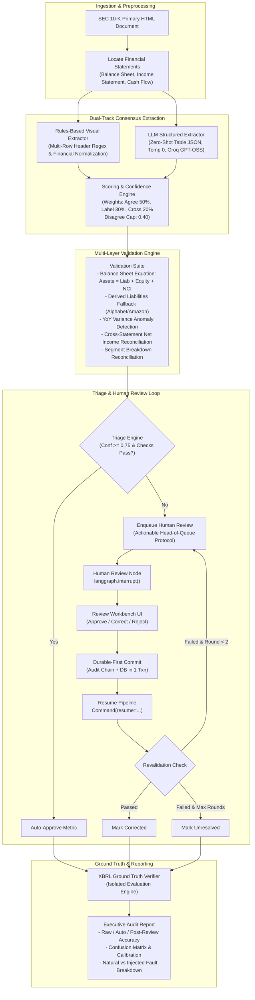

# VantageAudit — Human-in-the-Loop Financial Filing Auditor Agent

> *"A system that knows when to distrust itself, and proves it survives being killed mid-run."*

[](backend/tests/)
[-blue?style=flat-square)](eval/results.json)
[](https://fastapi.tiangolo.com)
[](https://langchain-ai.github.io/langgraph/)
[](https://react.dev/)
[](LICENSE)

VantageAudit is an enterprise-grade agentic financial filing auditor engineered to ingest messy, un-tagged SEC 10-K visual HTML filings, extract critical financial statement metrics via parallel dual-track consensus (deterministic rules engine + LLM table interpreter), execute multi-layer accounting validation equations, and escalate borderline anomalies to a human review workbench.

Equipped with **durable-first LangGraph state checkpointing on SQLite**, VantageAudit is resilient to mid-flight process crashes (`kill -9`). Upon restart, it automatically reconciles in-flight pipelines, replays audit events, and resumes human review workflows with **zero duplicate LLM network calls**.

---

## 🏛️ System Architecture



---

## ⚡ Key Architectural Features

### 1. Dual-Track Consensus Scoring
- **Rules Extractor**: Parses visual HTML tables without reading hidden XBRL tags (`ix:*`), normalized across negative notations `(1,234)`, dashes as zero `—`, currency markers `$`, and multiplier scales (Millions, Thousands, Billions).
- **LLM Extractor**: Submits located plain-text financial statement tables to an LLM (`openai/gpt-oss-120b` with `gemini-3.5-flash` fallback) in strict JSON mode with prompt caching.
- **Scoring**: Computes weighted confidence. If rules and LLM disagree on extracted values, confidence is strictly capped at `0.40`, guaranteeing immediate human triage.

### 2. Multi-Layer Accounting Validation
- **Accounting Equation**: Verifies $\text{Assets} = \text{Liabilities} + \text{Shareholders' Equity} + \text{Non-Controlling Interests (NCI)}$.
- **Derived Liabilities**: Automatically derives Total Liabilities for filings omitting explicit summary liability line items (e.g. Alphabet, Amazon).
- **YoY Anomaly Detection**: Flags metric changes exceeding $\pm 50\%$ with cached LLM-generated business rationales.
- **Cross-Statement Corroboration**: Cross-references Income Statement Net Income against Cash Flow operating activities starting lines.

### 3. Kill-Resume Durability & Idempotency
- **Durable Checkpointer**: Checkpoints state to `checkpoints.db` via `AsyncSqliteSaver` using strict MsgPack serialization (`LANGGRAPH_STRICT_MSGPACK=true`).
- **Hard-Kill Survivability**: Can be hard-killed at any graph execution step (`kill -9` / `taskkill /F /PID`). On boot, the startup reconciler resumes paused runs and replays decisions with **zero duplicate LLM network calls** served from `llm_calls` cache.
- **Append-Only Cryptographic Audit Log**: Every human decision records `original_value`, `corrected_value`, `reviewer`, `reasons`, and `timestamp` into a SHA-256 hash-chained ledger. SQLite database triggers raise `ABORT` on any `UPDATE` or `DELETE` statements.

### 4. Interactive Review Workbench
- Dense, dark-themed UI built with React 19, TypeScript, Tailwind CSS, `@xyflow/react`, and Lucide icons.
- Displays full 10-K source snippet with highlighted target table cell, live confidence breakdown radial gauge, and direct SEC EDGAR links.
- Supports hotkeys (`A` to approve, `E` to edit/correct, `R` to reject, `J`/`K` navigation), presenter mode, and WebSocket stream with `since_seq` event replay.

---

## 🚀 Quickstart

### Prerequisites
- **Python**: $\ge 3.11$ (tested on Python 3.13)
- **Node.js**: $\ge 20$ (tested on Node v25)
- **Git**

### Installation

1. **Clone Repository**:
   ```bash
   git clone https://github.com/Pranav-S-Chakrapani/Human-in-the-Loop-Financial-Filing-Auditor-Agent.git
   cd Human-in-the-Loop-Financial-Filing-Auditor-Agent
   ```

2. **Configure Environment**:
   ```bash
   cp .env.example .env
   ```
   Add your API keys to `.env`:
   ```ini
   GROQ_API_KEY=gsk_your_groq_api_key_here
   GEMINI_API_KEY=AIzaSy_your_gemini_api_key_here
   EDGAR_USER_AGENT=FilingAuditor your_real_email@example.com
   ```

3. **Backend Setup**:
   ```bash
   python -m venv backend/.venv
   # Windows:
   .\backend\.venv\Scripts\Activate.ps1
   # macOS/Linux:
   source backend/.venv/bin/activate

   pip install -r backend/requirements.txt
   ```

4. **Frontend Setup**:
   ```bash
   cd frontend
   npm install
   cd ..
   ```

---

## 🖥️ Running the Application

### 1. Launch FastAPI Backend
From repository root:
```bash
python -m uvicorn backend.app.api.main:app --host 127.0.0.1 --port 8000
```
- **API Docs (Swagger UI)**: [http://127.0.0.1:8000/docs](http://127.0.0.1:8000/docs)
- **Health Check**: [http://127.0.0.1:8000/health](http://127.0.0.1:8000/health)
- **WebSocket Feed**: `ws://127.0.0.1:8000/ws/events?since_seq=0`

### 2. Launch React Frontend
In a separate terminal:
```bash
cd frontend
npm run dev
```
Open [http://localhost:5173](http://localhost:5173) in your browser.

> **Mock Mode**: To inspect UI components without a live backend, set `VITE_USE_MOCKS=true` in `frontend/.env.local`.

---

## 🧪 Testing & Verification

The test suite thoroughly validates database triggers, hash chains, idempotency, ground-truth isolation, and mid-run recovery.

### Run All Pytest Tests
```bash
pytest backend/tests/ -v
```

### Run Automated Kill-Resume Durability Test
Spawns the backend as a subprocess, arms faults, halts at `interrupt()`, hard-kills the server with `taskkill /F` or `kill -9`, restarts, and asserts 0 duplicate LLM calls and exact state recovery across 10 iterations:
```bash
python eval/kill_resume_test.py
```
*Current Evaluation Result*: **10/10 Passed (100% Pass Rate)** recorded in `eval/results.json`.

### Run Independent Report Check
Recomputes all accuracy, confusion matrix, and calibration statistics independently from raw SQLite rows and asserts exact parity with `GET /report`:
```bash
python eval/report_check.py
```

### Run Mid-Flight Chaos Injections
Simulates crashes after `locate`, `extract_llm`, `score`, and `validate`:
```bash
python eval/chaos.py
```

---

## 📊 Endpoints & API Reference

| Method | Endpoint | Description |
|---|---|---|
| `GET` | `/health` | System health, checkpointer type, LLM call counts, recovered runs. |
| `POST` | `/runs` | Launch filing audit for tickers (`AAPL`, `MSFT`, `KO`, `NVDA`, `AMZN`, `GOOGL`, `TSLA`, `META`). |
| `GET` | `/runs/{id}` | Detailed status, extracted metrics, and validation checks for a run. |
| `GET` | `/reviews` | List all reviews with actionable head-of-queue flags. |
| `GET` | `/reviews/{id}` | Detailed review payload: snippet HTML, coordinate highlights, confidence breakdown. |
| `POST` | `/reviews/{id}/decision` | Submit durable human decision (`approve`, `correct`, `reject`). |
| `GET` | `/report` | Executive accuracy, confusion matrix, calibration buckets, natural vs injected split. |
| `GET` | `/audit` | Query append-only audit trail. |
| `GET` | `/audit/verify` | Recompute and verify cryptographic SHA-256 hash chain. |
| `POST` | `/admin/inject-fault` | Arm fault injection (`wrong_row`, `wrong_column`, `wrong_scale`, `llm_hallucination`). |
| `POST` | `/admin/tamper` | Tamper simulation proving database triggers abort `UPDATE` and `DELETE`. |

---

## 🛡️ Hackathon Evaluation Guarantees

1. **Ground Truth Isolation**: SEC XBRL Company Facts is imported *only* in `groundtruth.py`, called strictly by `verify.py` and `report.py`. Zero leakage into extraction or scoring code (`test_ground_truth_isolation.py` enforces this).
2. **Visual Parsing Integrity**: 10-K documents are parsed visually from element text; no XBRL tags (`ix:*`) or EdgarTools APIs are used for extraction.
3. **No Fabricated Numbers**: Report metrics and calibration scores are computed strictly from stored SQLite rows.
4. **Zero Duplicate Egress on Restart**: Resuming an interrupted workflow generates zero redundant network calls against LLM endpoints.

---

## 📜 License
MIT License. Created during the 2026 Financial AI Agent Hackathon.
